# CornerTodo · 角落待办

放在 Windows 桌面右上角的本地待办工具。用一句话记录要做的事，按需选择截止日期，完成后勾选归档。可定制颜色与透明度，默认在桌面显示，也可自行开启悬浮置顶，在其他办公窗口上方查看待办。

当前 Windows 源码版本为 **v1.8.0**。另有独立的 Mac 实验性内测版，可下载文件以本仓库的 **Releases** 页面为准。

v1.8.0 新增默认关闭的到期提醒。勾选「提醒我」后才展开天／小时／分钟选择，组合成一个提前时长，全为0表示到期提醒。程序运行期间通过独立小卡片提示，保留已有悬浮、重复任务、无截止日期、外观与登录自启功能。更新内容见 [更新记录](CHANGELOG.md)，开发者可从 [架构与构建说明](docs/DEVELOPMENT.md) 了解各组件的职责。

## v1.8.0 到期提醒

| 默认关闭，勾选后才展开 | 天／小时／分钟组合点选 |
| :---: | :---: |
| [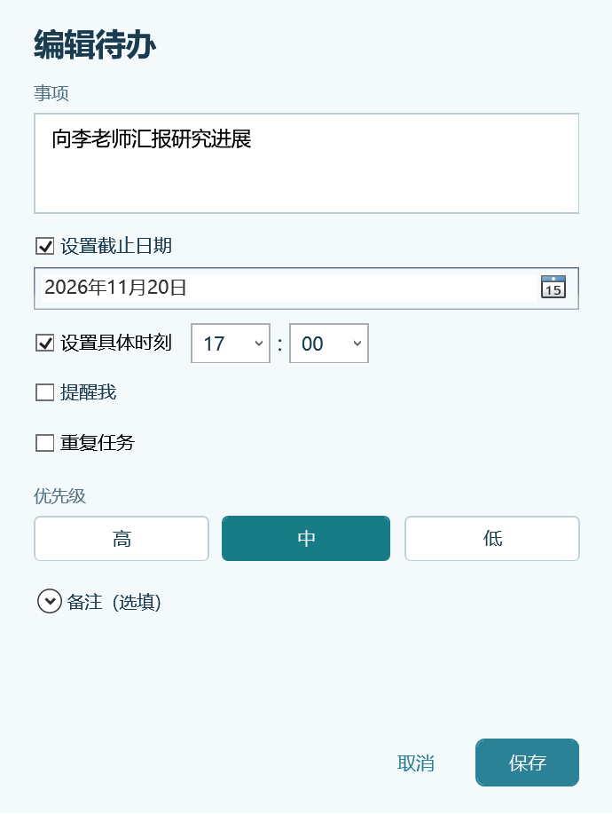](docs/images/reminder-default.png) | [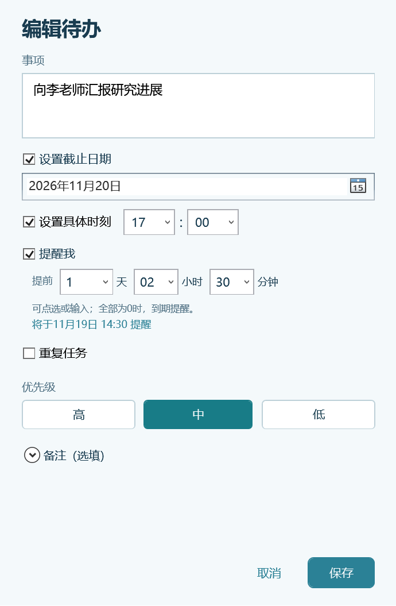](docs/images/reminder-editor.png) |

[](docs/images/reminder-card.png)

以上图片使用合成事项和实际控件，展示布局；不作为原生窗口层级、焦点或到点投递的实机证明。提醒的运行范围见[到期提醒](#到期提醒)。

## v1.7.0 视觉统一与悬浮显示

| 浅色操作区与细滚动条 | 深色主题 |
| :---: | :---: |
| [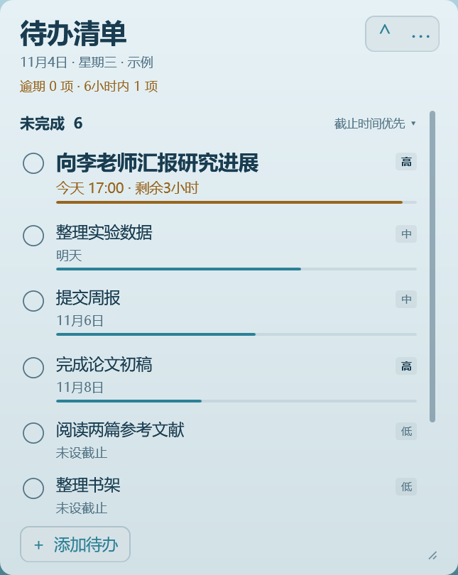](docs/images/unified-panel.png) | [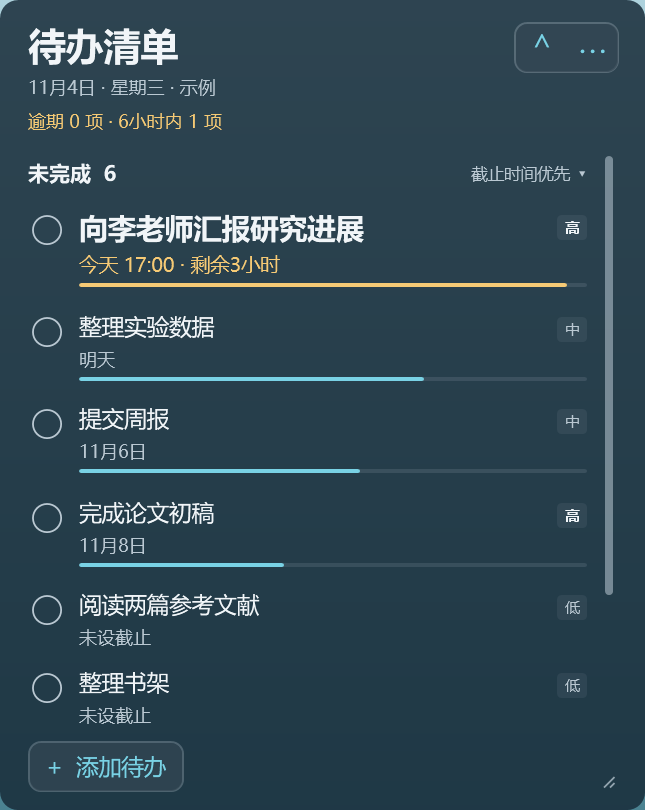](docs/images/unified-dark-panel.png) |

从「⋯ → 显示方式」选择「仅在桌面显示」或「悬浮在其他窗口上方」，默认使用桌面模式。以上图片展示配色与布局，不作为原生窗口置顶的验证结果；具体行为见下方[显示方式](#显示方式)。

## v1.6.0 重复任务

| 默认关闭，普通事项只增加一行 | 勾选后展开每周设置 |
| :---: | :---: |
| [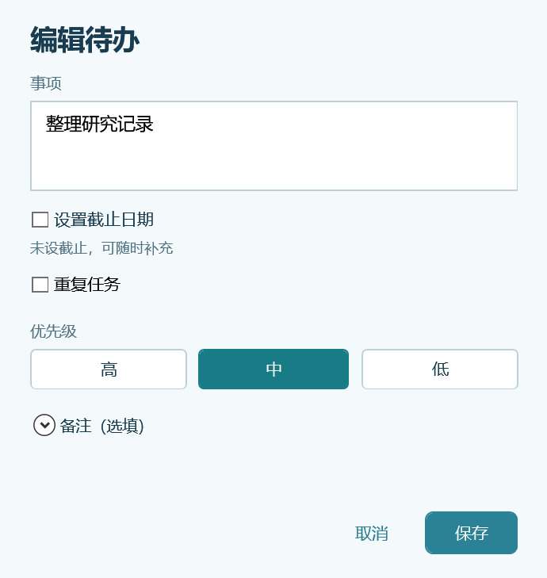](docs/images/recurring-editor-default.png) | [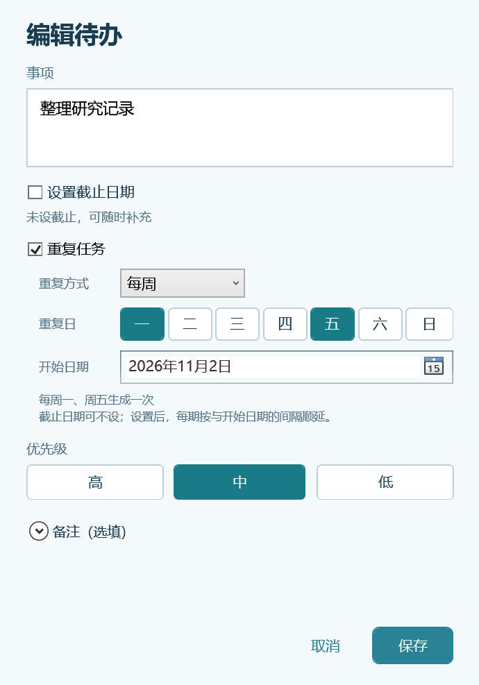](docs/images/recurring-editor-weekly.png) |
| **列表中的重复事项** | **规则管理与暂停恢复** |
| [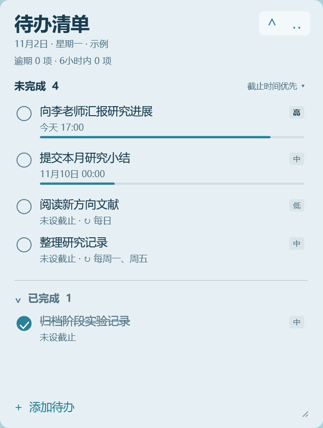](docs/images/recurring-panel.png) | [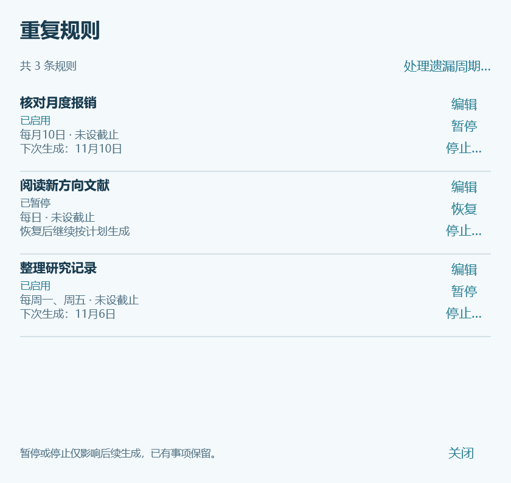](docs/images/recurring-management.png) |

## v1.5.0 无日期与滚动条

| 有日期与无日期事项 | 无日期编辑窗口 |
| :---: | :---: |
| [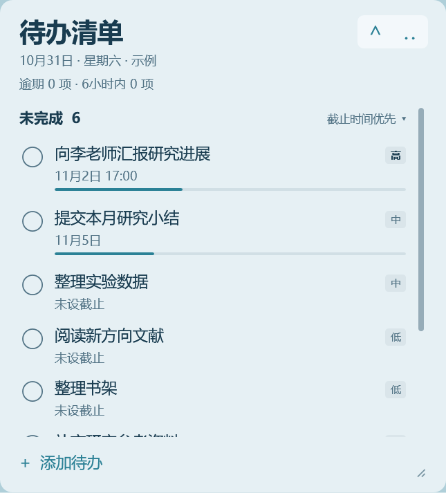](docs/images/no-deadline-panel.png) | [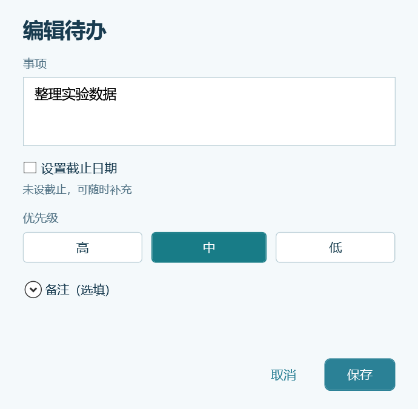](docs/images/no-deadline-editor.png) |

## macOS 实验性内测版

Mac 内测分支已更新至 **0.2.0-alpha.1（构建 0.2.1）**，目标 macOS 14+，提供 Apple M 系列 arm64 与 Intel x64 两种包；实际可下载附件以 Releases 为准。见 [Mac 使用说明与界面展示](macOS/README.md)、[本轮更新](macOS/RELEASE_NOTES.md)、[内测清单](macOS/TESTING.md) 和 [反馈模板](macOS/FEEDBACK.txt)。

本轮 Mac 交付无截止日期、统一操作区与细滚动条、旧数据迁移前备份、版本与反馈信息。共享源码保存 Version 4 数据并保留 Windows 的重复规则、提醒和悬浮偏好，但 **Mac 尚未接入重复任务设置／生成／管理、提醒卡片／调度或悬浮切换**。旧 alpha.1 包和标签保留，不能读取新版数据。

Mac 包由 Windows 交叉构建，原生启动、菜单栏、Spaces、全屏、多屏与休眠仍需 Mac 用户实测，也未完成 Developer ID 签名和 Apple 公证。下方主体功能与 WPF 图片主要对应 Windows 版；Mac 辅助图片另在 Mac 文档标明渲染环境。

## 界面预览

以下图片均为实际 WPF 控件渲染，使用示例事项。基础功能图片沿用既有展示，新版无截止日期界面见上方两图。点击图片可查看大图。

| 待办列表、时间细条与优先级 | 备注编辑 |
| :---: | :---: |
| [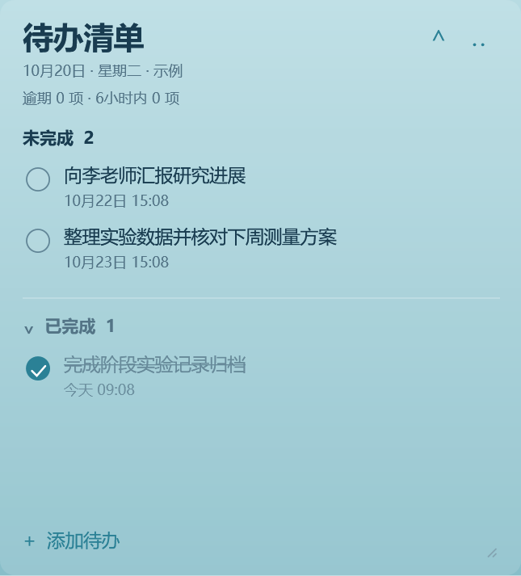](docs/images/normal.png) | [](docs/images/notes-editor.png) |
| **临近截止，面板逐渐扩大** | **逾期持续督促** |
| [](docs/images/urgent.png) | [](docs/images/overdue.png) |
| **深色主题** | **外观与透明度设置** |
| [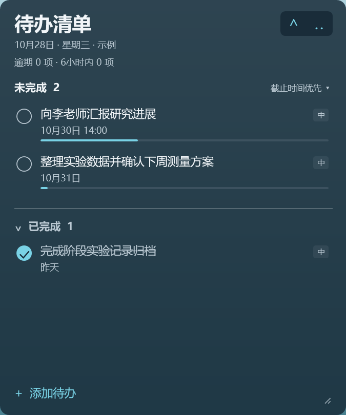](docs/images/dark.png) | [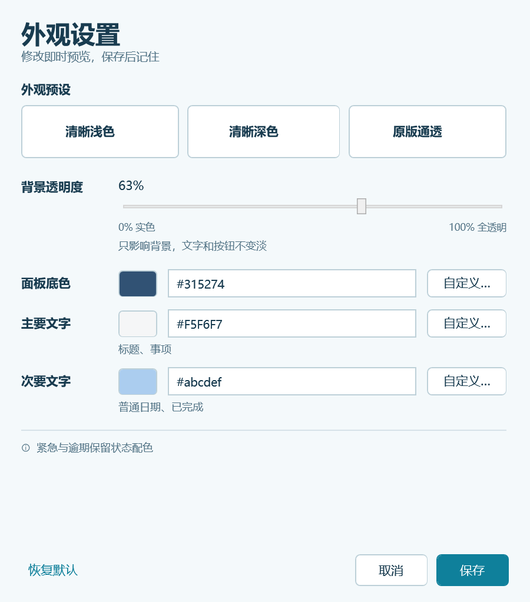](docs/images/appearance-editor.png) |

### v1.4.0 新交互

| 小时／分钟分别点选 | 开启贴边收起后的展开面板 |
| :---: | :---: |
| [](docs/images/time-picker.png) | [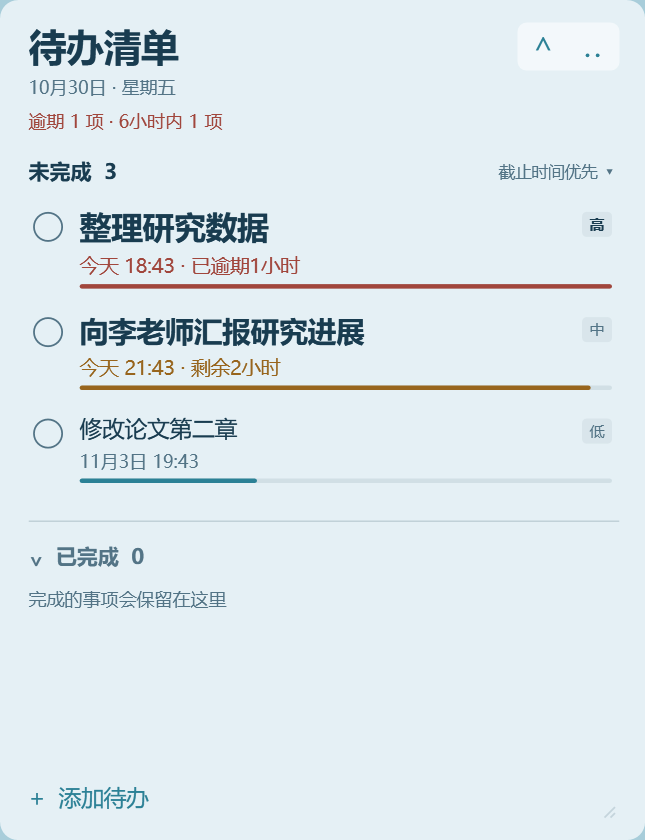](docs/images/edge-expanded.png) |
| **收起后的胶囊条** | **默认关闭，按需开启** |
| [](docs/images/edge-capsule.png) | 从「⋯」菜单开启「贴边自动收起」，拖到主屏右侧后，鼠标离开约 0.8 秒收起。点击胶囊展开；编辑或菜单打开时保持展开。 |

## 功能

- 无边框、半透明的面板，默认在桌面右上角，可自行开启悬浮置顶并保存选择。
- 顶部操作区与「添加待办」统一底色、圆角和交互反馈，配合浅色、深色及自定义外观。
- 外观设置：调整背景透明度、背景色和主要／次要文字颜色，提供浅色、深色和原版预设，实时预览后选择保存或取消。
- 重复任务默认关闭，按需设置每日、每周多选星期或每月几号／月底，开始日期独立于截止日期；每一期独立记录，不因完成晚了而改变后续计划。
- 输入完整事项，可不设置截止日期；需要时再选择日期与具体时刻，小时／分钟分别点选或键盘输入，句子中的人物和时间无需拆成字段。
- 「未完成／已完成」两种状态。勾选后移入已完成区域并划线，取消勾选可恢复。
- 双击或右键编辑，右键删除并确认；事项可添加多行纯文字备注，完成后仍保留。
- 优先级为高／中／低，默认中；未完成可选择截止时间优先或优先级优先，已完成按完成时间倒序。
- 有截止日期的未完成事项下方显示约 3 像素的时间进度细条，鼠标悬停查看时间已用比例；到期满格，完成或无截止时隐藏。
- 日期显示「今天」「明天」或具体日期；临近截止显示剩余时间，逾期显示已逾期时长。
- 拖动标题移动位置，记住位置与常态大小；长文字换行、列表滚动，已完成区域和整个面板均可收起。
- 可选「贴边自动收起」，默认关闭：支持主屏右侧，鼠标离开片刻后收成胶囊条，点击展开；胶囊显示未完成总数及其中逾期数。
- 数据自动保存到本机。可选到期提醒在程序运行期间显示独立卡片；应用不联网，没有声音提醒。
- 可自行开启登录自启动，默认关闭；首次运行和升级不会自动登记。

## 下载与运行

在仓库的 **Releases** 中下载 `CornerTodo-v1.8.0-windows-portable.zip`，完整解压到可写目录，再双击 `CornerTodo.exe`。程序不需要安装。再次启动同一份程序会展开已有面板并移回右上角；退出请使用面板「⋯」菜单中的「退出待办」。

`CornerTodo-v1.8.0-source.zip` 是源码包，含 Windows 工程与 Mac 开发分支，供阅读和构建。GitHub 自动生成的 `Source code` 压缩包也是源码快照。直接使用 Windows 程序请选择名称含 `windows-portable` 的压缩包。

系统目标为 **Windows 10 / 11，.NET Framework 4.7.2 或更新版本**。应用使用 C# / WPF 与 Windows 自带的框架库，没有第三方运行时依赖。桌面层显示会受到 Explorer、其他桌面工具、多显示器和缩放配置的影响，尚未保证所有环境组合的兼容性；无法连接桌面层时会提示并以普通窗口显示。

便携版尚未进行代码签名，Windows 或 SmartScreen 可能显示「未知发布者」等信任提示。请根据下载来源、源码和文件摘要决定是否运行，并保持系统防护开启。`SHA256SUMS.txt` 可用于核对文件是否一致，摘要本身不构成安全保证。

## 显示方式

从「⋯ → 显示方式」切换：

- **仅在桌面显示**：默认方式，其他软件可以覆盖面板。
- **悬浮在其他窗口上方**：面板与贴边胶囊显示在浏览器、文档编辑器等普通窗口上方；切换后保留事项、常态位置与尺寸，选择保存在本地。

桌面和悬浮模式各自保存「随截止时间扩大」开关。桌面沿用原偏好；悬浮默认关闭自动扩大，使用常态尺寸，可在当前模式下自行开启。悬浮中也可使用贴边收起，鼠标离开后收成可点击的胶囊。

悬浮目标是普通应用窗口，不承诺覆盖独占全屏、其他置顶窗口或系统安全界面。切换、编辑窗口与菜单、Win+D、Explorer 重启及多屏／显示缩放需要按实际设备检查；这一显示选项不是到期弹窗提醒。

## 到期提醒

默认只显示一行未勾选的「提醒我」，勾选后才展开提前天数、小时和分钟。三者合成一次提醒的提前时长：天数0–3650、小时0–23、分钟0–59，均可点选或键盘输入；全部为0表示到期提醒。初次开启的草稿为提前15分钟，保存才生效。下方实时显示准确提醒日期和时刻。

先设置截止日期与具体时刻才能启用提醒。取消日期或具体时刻会关闭提醒；无截止日期事项仍可正常保存。新建或改期后的提醒时间已经过去时不突然补弹，编辑器会提示。

提醒在 CornerTodo 保持运行时检查，包括面板收起或被其他软件遮挡时。卡片独立于桌面／悬浮模式，使用清晰底色；自动出现时不主动切走输入焦点。可查看事项或标记完成，右上角关闭仅收起卡片。多项同时到点合并展示，主面板不会被强制展开。

提醒处理状态保存在本地，避免重启或窗口恢复重复提示。完成、删除、关闭提醒或变更计划后，旧卡片会撤下；只改正文、备注或优先级不重置计划。重开或睡眠恢复后，对最近24小时内错过的有效提醒合并提示，较早记录跳过；显式补建的历史周期不逐条弹窗。程序自己的编辑器、菜单或模态窗口打开时会暂缓展示，关闭后再检查。

重复规则可保存提醒设置，每一期独立处理。若提前时长使提醒早于该期生成日期，运行中的程序会在提醒到点时提前生成对应事项，并记录该期，避免后来再次生成；未开启提醒的重复事项仍按原日历日期生成。修改后续规则不改变已生成事项的提醒。

退出、关机或睡眠期间不执行检查，不会唤醒电脑；本版没有声音、系统后台通知或手机同步。实际投递、焦点和不同显示环境应先使用示例数据试用。

## 重复任务

新建或编辑普通事项时，默认只显示未勾选的「重复任务」一行。勾选后展开重复方式和开始日期：每日无需其他日期条件；每周可多选星期；每月可选1–31日或每月最后一天。取消勾选会收起当前草稿，点击保存才生效。重复日期负责生成，不是提醒时间；无截止日期的事项也可重复。

每月29／30／31日遇到短月采用当月最后一天，后续月份恢复原定日期。计划固定在日历日期上，不随实际完成时间顺延。若有截止日期，每期使用首期截止相对开始日期的天数间隔，以及可选的具体时刻；开始日期后移时请核对截止日期与界面提示。

程序运行或重新打开时检查到期计划；未来开始的规则保存在「⋯ → 管理重复任务」，不会提前展开全部未来事项。每期事项、完成记录与当时的循环标签独立保留；上一期未完成不覆盖、不阻止新一期，删除本次后也不会在重启时重新生成。

右键重复事项可选择编辑本次、修改后续规则、暂停／恢复、停止后续或删除本次；修改本次不改变模板，修改后续不改变已有事项。管理窗口可查看下次生成日期。暂停或修改规则前须先处理已存在的漏期；恢复从当前计划继续，不追补暂停期间。停止会取消后续生成及尚未生成的遗漏周期，已生成事项和完成历史保留。

重新打开遇到遗漏周期时，汇总后选择「补建」「跳过」或「稍后处理」。每批最多补建366项，剩余遗漏继续待处理；稍后不会推进处理进度。程序退出或电脑关机期间不运行生成；可选提醒的运行范围见[到期提醒](#到期提醒)。

## 开机自启（登录后）

默认关闭。首次运行和升级不会自动开启；需要时，在面板「⋯」菜单点击「开机自启（登录后）」。开启后，当前 Windows 用户下次登录时会启动 CornerTodo；关闭时仅删除本工具管理的快捷方式。

- 登记使用当前用户启动文件夹中的 `CornerTodo-LoginStartup.lnk`，不在 `Data\todos.json` 保存跨机器的启用开关。菜单勾选表示受管快捷方式已登记。
- Windows 若在系统设置或任务管理器中禁用了该启动项，菜单仍可能显示已登记；需要你在 Windows 中重新启用。程序不会偷偷重建快捷方式来绕过禁用。
- 从菜单退出只结束本次运行，保留登录自启动登记。自动重复启动会静默退出，不展开或重置已经运行的面板。
- 原目录升级并保留程序路径时，已开启的登记继续保留。移动目录后，请手动打开新位置的程序，再点击「更新自启位置为当前程序」；程序不会自动替换旧目标。
- 删除软件前，请先从菜单关闭登录自启动，避免留下失效的快捷方式。

更多说明和手动检查步骤见 [登录自启动说明](docs/STARTUP.md)。

## 外观设置

从面板「⋯」菜单打开「外观设置」。背景透明度可在 0%～100% 之间调节：0% 为实色背景，100% 为全透明背景。该设置只影响背景，主要与次要文字不会跟着变淡。

可分别选择背景色、主要文字色与次要文字色，使用颜色选择器或填写 `#RRGGBB` 色值；也可选择浅色、深色或恢复原版外观。调整会实时预览，点击「保存」才会写入本地设置；取消或关闭设置窗口会恢复已保存的外观。预设选择同样遵循预览与保存规则。

紧急与逾期提示保留状态配色。顶部操作区和「添加待办」采用一致的主题底色、圆角、描边及交互反馈，背景全透明时仍保留可辨认的操作入口；如果配色不易辨认，可在「⋯」菜单选择「恢复清晰浅色」，直接恢复并保存默认外观。

新数据默认使用清晰浅色；旧版数据缺少外观设置时自动沿用原版外观。外观设置与待办数据一起保存在本地，修改外观不会改变事项、截止时间或保存的常态尺寸。

## 时刻点选

添加或编辑事项时，勾选「设置截止日期」后可选择日期，再勾选「设置具体时刻」，可分别点选小时 `00–23` 和分钟 `00–59`，也可在两个选择框中使用键盘输入。例如 `17` 和 `23` 表示 17:23，无需手动输入冒号。只取消具体时刻则保存日期；取消截止日期则保存为「未设截止」。

## 无截止日期与简约滚动条

新建默认勾选「设置截止日期」。取消后日期和具体时刻控件收起，可直接记录想做的事；编辑已有无日期事项时保持关闭。无日期事项的正文、优先级和备注照常显示，次行标注「未设截止」，没有时间条、倒计时或临期／逾期字号放大；仍计入未完成总数和贴边胶囊数量。

截止时间优先时，有日期事项按有效截止在前，无日期事项按创建时间、ID 稳定排在后。优先级优先时，先按高／中／低排列，同级内有日期在前、无日期在后。后补截止日期从本次保存开始计算时间进度；取消截止后停止贡献面板紧迫度，面板根据其他事项重新计算。

主面板内容溢出时显示圆角细滑块，轨道透明，没有上下箭头；悬停和拖动时加深，操作区保持固定宽度，避免文字换行跳动。滚动条配色跟随主要／次要文字色，不会随面板背景透明度一起消失，滚轮和拖动操作继续可用。

编辑已有事项会带出原来的本地时刻。日期和时刻没有变化时，保留原始截止精度，不会因为打开编辑窗口或重新选择相同时刻而重置时间进度。输入不合法或保存失败时，窗口保留输入供修改与重试。

## 备注、优先级与排序

添加或编辑事项时，可展开「备注（选填）」输入多行纯文字。新建时默认收起，编辑已有备注的事项时自动展开。列表只为有备注的事项显示小图标，点击图标即可进入备注；正文不铺满桌面。完成或恢复事项都保留备注，取消编辑不会保存本次输入。

优先级可选「高／中／低」，新事项和缺少优先级的旧事项均默认为「中」。列表使用简短标签，不显示 P1、P2 等编号。排序有两种选择，并在本机记住：

- **截止时间优先**：默认方式，越早截止越靠前。
- **优先级优先**：高 → 中 → 低，同级内越早截止越靠前。

优先级优先模式不会另外强制逾期置顶，因此下个月截止的高优先级事项可能排在今天截止的中优先级事项前面。两种排序下，临期和逾期提示都会继续显示。已完成区域仍按完成时间倒序。

## 时间进度与自动扩大

未完成事项的时间条按各自的完整期限线性推进：创建事项或重新设置有效截止时间时为起点，到截止时达到 100%。三天、五天、一个月的事项分别按自己的时间跨度计算。约 3 像素的细条位于截止信息下方，不常驻显示百分比；鼠标悬停可查看「时间已用」比例。它表示已经过去的时间，不表示工作完成度。

逾期后时间条保持满格，同时显示逾期时长；已完成事项隐藏时间条，恢复未完成后按当前时间重新显示。重新打开程序、修改事项文字、备注、优先级或排序，都不会重置起点。旧事项优先使用已保存的截止设定时间，缺少该值时使用创建时间。

时间条和面板扩大分别计算。时间条使用完整任务周期，面板扩大继续采用下方的临期规则。

桌面模式默认开启「随截止时间扩大」，悬浮模式默认关闭，两者分别保存。开启时，未完成事项在截止前的最后 24 小时内推动面板逐渐扩大，越接近截止增长越快。如果创建或重新设置截止时间时只剩不足 24 小时，则使用这段较短的时间。例如，5 分钟后截止的事项会在这 5 分钟内逐渐扩大。重新打开程序或仅修改事项文字、备注、优先级不会重置增长进度。

- 面板以右上角为锚点，向左、向下平滑扩大。最大宽度为当前桌面工作区的一半，高度约为 72%；以 2560 × 1528 的工作区为参考，上限为 1280 × 1100。实际尺寸按工作区比例和系统 DPI 换算，并受屏幕边界限制。
- 多条事项共同影响一个面板：最紧迫的一条贡献最大，另外两条最紧迫的事项少量叠加。更多事项不会让面板突破上限。
- 所有尚未逾期、距截止不超过 6 小时的未完成事项都会放大、加粗文字，并显示剩余时间；所有逾期未完成事项使用更大的加粗文字。标题分别汇总逾期和 6 小时内的数量，两组不重复计数。
- 面板展开且开启自动扩大时，只要还有一条逾期未完成事项，就持续保持最大面板，逾期越久也不会自动减弱。完成、删除或调整该事项的截止时间后，按剩余事项重新计算；紧迫程度降低时平滑回落。
- 仅填写日期的事项在当天结束前仍有效，到次日零点才逾期；填写具体时刻的事项在到达该时刻后逾期。
- 鼠标停留在面板上、拖动、调整大小、打开菜单或编辑事项时，自动变化暂停；交互结束且鼠标离开后恢复，避免操作目标移动。
- 在「⋯」菜单关闭「随截止时间扩大」可回到常态大小，再拖动右下角调整基准；重新开启后按当前紧迫程度计算。自动扩大的尺寸不会覆盖保存的常态大小。收起时保持紧凑尺寸，展开后恢复相应大小。

## 贴边自动收起

从「⋯」菜单开启「贴边自动收起」。该选项默认关闭，并随本地设置保存；旧版数据缺少该字段时同样保持关闭。首版支持主屏右侧：开启后，面板靠近右边缘可吸附，拖离边缘则继续以普通面板使用。

贴边后，鼠标真正离开面板约 800 毫秒才收起成胶囊条。点击胶囊展开；仅把鼠标移到胶囊上不会自动展开。编辑任务、打开菜单或拖动时不会自动收起。胶囊显示未完成总数及其中的逾期数量，例如「未完成 3／逾期 1」表示三项中有一项逾期。

胶囊状态优先于截止时间驱动的扩大，收起期间不会因为到期或逾期反复弹出；展开时按当前模式的扩大开关和紧急程度恢复尺寸。原有标题栏手动收起与贴边状态独立，临时胶囊尺寸不会覆盖保存的常态大小。桌面模式下其他软件可覆盖胶囊和面板；悬浮模式下它们保持在普通窗口上方。

需要找回时，可在菜单选择「恢复右上角位置」，或再次双击同一份 `CornerTodo.exe`；面板会展开，待鼠标实际移入或在面板内移动、随后离开时，才重新进入自动收起。关闭该选项后恢复普通面板。

## 本地数据与备份

默认数据位于 **`CornerTodo.exe` 同级的 `Data\todos.json`**，备份保存在同一数据目录。每份便携程序使用自己的 `Data`；换到新目录运行不会自动读取旧目录里的事项。日常修改自动保存，移动或升级前请保留并备份整个 `Data` 文件夹。

长期使用建议固定一个运行目录。本地开发工作区以 `dist\CornerTodo.exe` 作为日常入口，使用 `dist\Data`；升级时先退出旧版、备份数据，再更新程序文件并保留原 `Data`。开发构建和测试使用 `output` 下的独立目录，发布包不包含个人待办数据。

数据为本地 JSON 文件，没有加密；能够访问该文件的人可以读取其中的事项。遇到异常可检查数据目录中的 `CornerTodo.log`，日志记录启动、窗口状态、尺寸变化与错误，不记录事项文字。

v1.4.0 及更早的旧事项、截止日期与已有设置继续读取。旧数据缺少贴边字段时默认关闭；缺少备注、优先级或排序字段时采用空备注、中优先级和截止时间优先。升级前先退出旧程序并单独备份整个 `Data`，再替换程序文件、保留原数据。

v1.8.0 使用 Version 4 数据格式，保存提醒计划、处理状态及提前生成的重复期次。旧 Version 1／2／3 载入后只在内存迁移，首次成功保存才写新版；旧事项默认关闭提醒，原有日期、重复规则和显示设置保留。未知版本保留原文件并明确报错。**v1.7.0 及更早的 Windows 程序、已发布 Mac 0.1.0-alpha.1 不能读取 Version 4；回退应先恢复升级前单独保存的整个 Data 备份，再运行旧程序。** `todos.json.bak` 是滚动保存备份，不能代替升级前备份。

当前 Windows 功能面向本机使用，不包含手机端、跨设备同步、声音或系统后台通知、附件、富文本或子任务；Mac 内测独立分发。

## 本地工作区目录

维护者的本地目录按用途分开；公开源码包只包含源码、工程、文档和测试文件：

| 目录 | 用途 |
| --- | --- |
| `src`、`build`、`docs`、`tests` | 源码、构建工具、说明和测试 |
| `dist` | 固定的日常运行程序及其 `Data` |
| `output/build`、`output/dev` | 默认开发构建及指定的开发输出，使用独立数据 |
| `release/v版本号` | 各版本的源码包、便携包、校验文件和干净源码目录 |
| `archive/builds` | 历史构建目录，按原样保留其程序与数据 |
| `archive/packages` | 历次打包结果和回退存档 |
| `output` 下其他目录 | 测试记录、界面渲染和验证产物 |

`release/v1.8.0` 是版本容器，内部文件保留 `CornerTodo-v1.8.0-…` 完整名称。重复打包时，上一批文件会存入 `archive/packages/v版本号/previous-bundles-*`；它们是发布文件备份，待办数据备份仍在对应的 `Data` 内。`dist`、`release`、`archive` 和开发输出均留在本机。

## 从源码构建

项目提供脚本和 Visual Studio／MSBuild 两种开发入口，共用 `CornerTodo.Build.props` 中的显式源码、框架引用、测试元数据和公开文件白名单。生产源码按职责放在 `src/App`、`src/Tasks`、`src/UI`、`src/Windows`；工程和构建入口保留在根目录，仍编译为同一个 WPF 应用。详细说明见 [开发工程说明](docs/DEVELOPMENT.md)。

脚本构建使用 Windows PowerShell 和系统的 .NET Framework C# 编译器，无需另装 .NET SDK 或下载 NuGet 包。在项目根目录运行：

```powershell
powershell -NoProfile -File .\Build.ps1
```

默认输出为 `output\build\CornerTodo.exe`，需保留同目录的 `CornerTodo.exe.config`。构建脚本也会生成应用图标，日常 `dist` 继续使用固定程序和数据。需要另设开发输出并同时执行测试，可运行：

```powershell
powershell -NoProfile -File .\Build.ps1 -Test -OutputDirectory output\dev
```

此时程序输出位于 `output\dev`。构建不会自动启动程序、开启登录自启动或上传发布文件。

需要在 IDE 中阅读和调试时，打开 `CornerTodo.sln`。这是 **.NET Framework 4.7.2、C# 5、AnyCPU** 的传统 WPF 工程，开发环境需要相应的 Visual Studio／MSBuild 和 4.7.2 Targeting Pack。IDE 构建输出为 `bin\Debug` 或 `bin\Release`，不覆盖 `dist`；直接运行便携版不需要安装这些开发工具。

共享清单目前登记十二组功能测试，也可单独运行：

| 测试 | 命令 | 范围 |
| --- | --- | --- |
| 数据与截止规则 | `powershell -NoProfile -File .\tests\Run-StoreTests.ps1` | 保存、恢复、旧字段默认、贴边偏好往返、两种排序、线性时间进度、截止边界及紧迫程度 |
| 任务操作服务（Session） | `powershell -NoProfile -File .\tests\Run-SessionTests.ps1` | 备注／优先级／排序／贴边设置保存、命令与时间戳规则、保存失败不提交、快照隔离、预览无写盘；不创建 WPF 窗口 |
| 重复计划与生成 | `powershell -NoProfile -File .\tests\Run-RecurrenceTests.ps1` | 日／周／月、短月闰年、去重、历史保留、漏期分批、暂停恢复与失败事务 |
| 增长布局 | `powershell -NoProfile -File .\tests\Run-GrowthLayoutTests.ps1` | 尺寸上限、锚点、屏幕边界、DPI 与异常输入 |
| 面板交互控制器（Panel） | `powershell -NoProfile -File .\tests\Run-PanelTests.ps1` | 假屏幕宿主、可控时钟下的拖动、增长动画、贴边延迟收起／恢复及基准尺寸；不挂载桌面 |
| 面板视图（View） | `powershell -NoProfile -File .\tests\Run-ViewTests.ps1` | 控件树、胶囊计数、时刻点选和校验、事项呈现及操作意图转发；不显示窗口 |
| WPF 离屏界面 | `powershell -NoProfile -File .\tests\Run-OffscreenUiTests.ps1` | 示例界面布局与渲染，结果写入 `tests\visual-qa` |
| 外观设置界面 | `powershell -NoProfile -File .\tests\Run-AppearanceUiTests.ps1` | 背景透明度、主题预览／保存／回滚、编辑器交互，结果写入 `tests\appearance-qa` |
| 登录自启动 | `powershell -NoProfile -File .\tests\Run-StartupTests.ps1` | 登录参数、受管快捷方式登记／关闭／更新及菜单行为，使用隔离测试环境 |
| 单实例通信（Instance） | `powershell -NoProfile -File .\tests\Run-InstanceTests.ps1` | 独立命名空间内的实例身份、手动唤醒、自动重复静默及释放，不启动正式应用 |
| 桌面挂载调度（Desktop） | `powershell -NoProfile -File .\tests\Run-DesktopTests.ps1` | 假桌面适配器下的首次挂载、重试、句柄丢失及关闭后的回调清理 |
| 应用生命周期（Lifecycle） | `powershell -NoProfile -File .\tests\Run-LifecycleTests.ps1` | 假窗口与手动调度下的关闭、恢复、模态保护、最新快照及过期回调 |

界面呈现、面板交互、任务保存与应用生命周期分别由视图、控制器和服务负责；具体边界见 [开发工程说明](docs/DEVELOPMENT.md)。离屏渲染和假宿主测试不覆盖实际桌面的鼠标／键盘输入、原生桌面层组合、Explorer 重启及真实登录，仍需在目标 Windows 环境中检查。测试不会注销或重启电脑。

修改工程、共享清单、构建或打包流程时，还应单独运行 `powershell -NoProfile -File .\tests\Run-BuildTests.ps1`。这项深度构建回归在隔离副本中检查源码清单、源码移动与干净打包，不包含在共享清单登记的功能测试组中；详见开发说明。

## 预览与测试参数

| 参数 | 用途 |
| --- | --- |
| `--data-dir <路径>` | 使用指定数据目录 |
| `--preview` | 使用独立示例事项预览，不改动正式待办数据 |
| `--windowed` | 以普通窗口打开，便于界面检查 |

```powershell
.\output\build\CornerTodo.exe --preview --windowed
```

## 打包与发布

维护者可运行下面的命令。脚本会从公开源码清单建立干净副本，在副本中构建并运行现有测试，再将新程序打包；不会从日常 `dist` 目录复制个人数据。

```powershell
powershell -NoProfile -File .\Package.ps1 -Version 1.8.0
```

默认按 `VERSION` 输出到对应的 `release\v版本号`，本版产物位于 `release\v1.8.0`；仍可使用 `-OutputDirectory` 指定其他项目内目录：

- `CornerTodo-v1.8.0-source.zip`
- `CornerTodo-v1.8.0-windows-portable.zip`
- `SHA256SUMS.txt`

`release\v1.8.0\CornerTodo-v1.8.0-source` 保留包含 `src`、工程与构建入口的干净源码展开目录，可将其中的内容上传到 GitHub。从 v1.7.0 仓库更新时沿用现有目录结构；确认源码更新完整后，再创建 v1.8.0 标签，并保留 v1.7.0 及更早的 Release 和标签。发布前运行全部测试，并核对本次 `PACKAGE-REPORT.txt` 与文件摘要。完整的网页操作步骤见 [发布说明](docs/PUBLISHING.md)。

## 许可证

本项目采用 [MIT 许可证](LICENSE)。Copyright (c) 2026 CornerTodo contributors。
