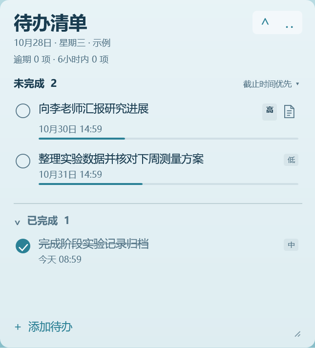
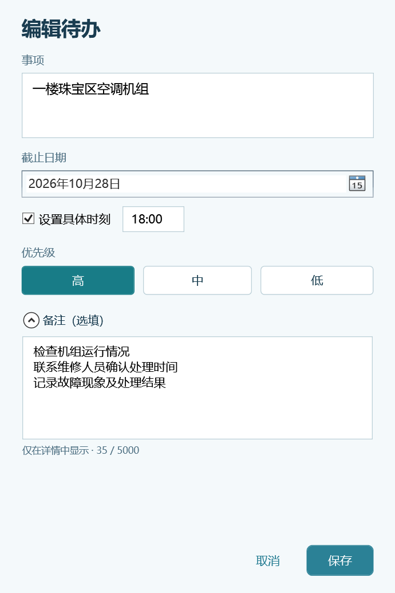
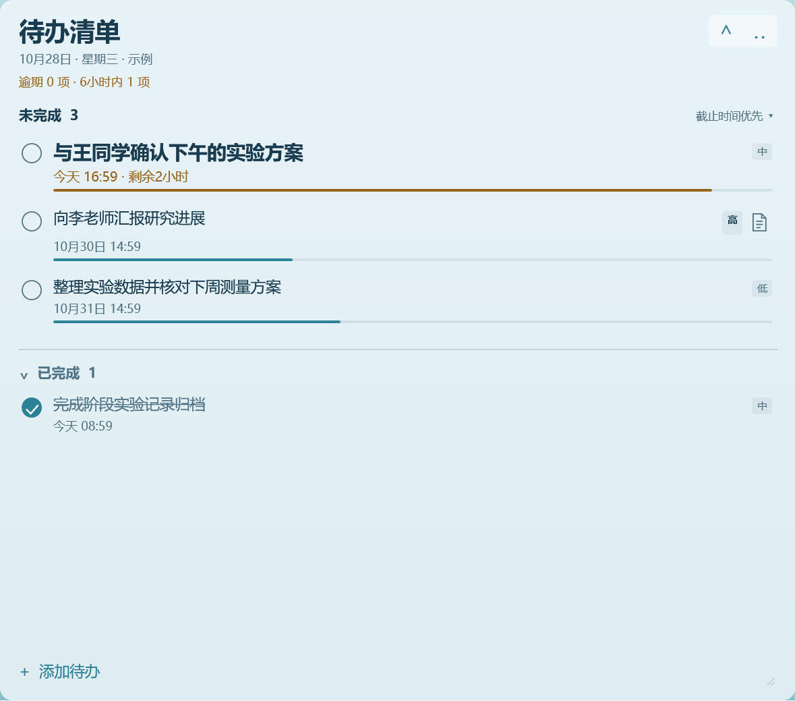
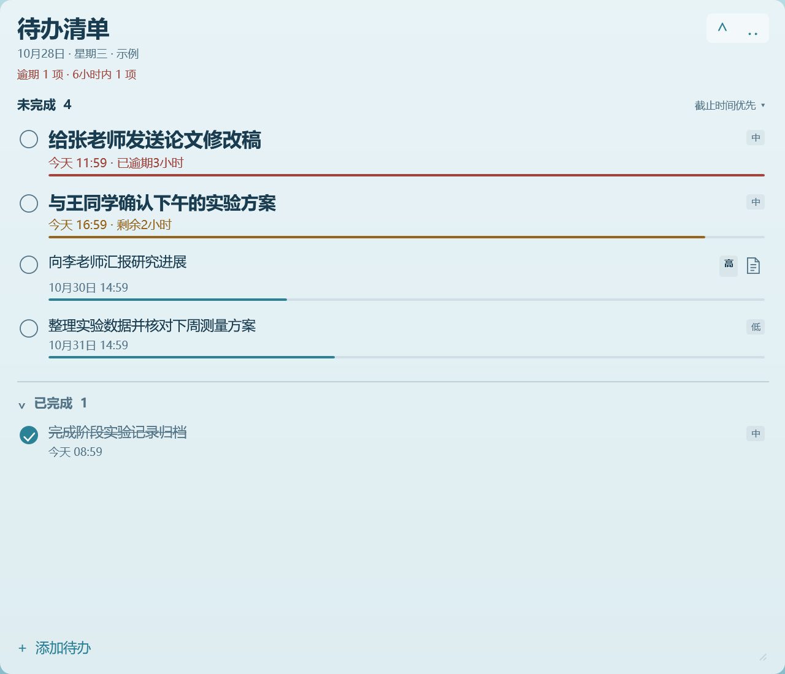
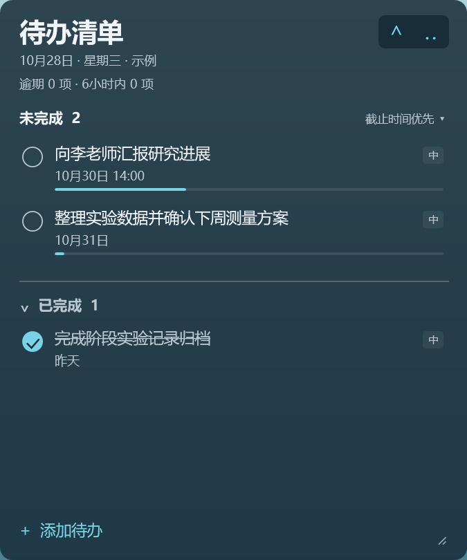
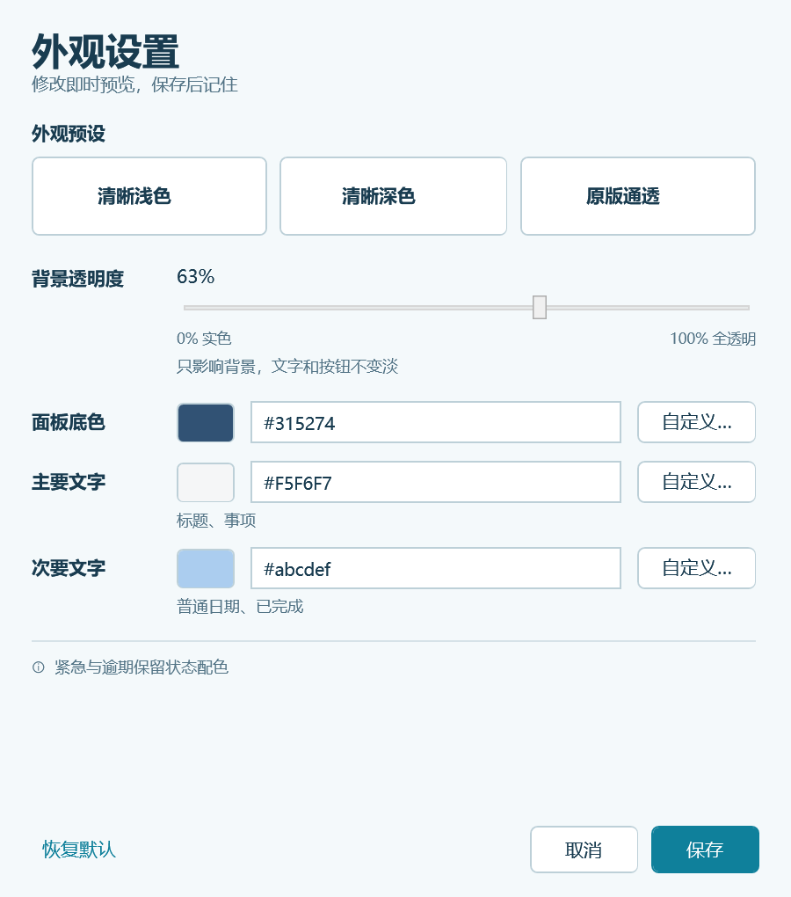

# CornerTodo · 角落待办

放在 Windows 桌面右上角的本地待办工具。用一句话记录要做的事，选择截止日期，完成后勾选归档。可定制颜色与透明度的面板保留桌面观感，临近截止时会逐渐扩大，提醒你关注尚未完成的事项。

当前源码版本为 **v1.3.0**。可下载文件以本仓库的 **Releases** 页面为准。

v1.3.0 增加事项备注、时间进度细条，以及高／中／低优先级和排序选择。更新内容见 [更新记录](CHANGELOG.md)，开发者可从 [架构与构建说明](docs/DEVELOPMENT.md) 了解各组件的职责。

## 界面预览

以下为 v1.3.0 的实际 WPF 界面渲染，均使用示例事项。点击图片可查看大图。

| 待办列表、时间细条与优先级 | 备注编辑 |
| :---: | :---: |
| [](docs/images/normal.png) | [](docs/images/notes-editor.png) |
| **临近截止，面板逐渐扩大** | **逾期持续督促** |
| [](docs/images/urgent.png) | [](docs/images/overdue.png) |
| **深色主题** | **外观与透明度设置** |
| [](docs/images/dark.png) | [](docs/images/appearance-editor.png) |

## 功能

- 无边框、半透明的桌面面板，默认位于右上角，其他软件可覆盖它。
- 外观设置：调整背景透明度、背景色和主要／次要文字颜色，提供浅色、深色和原版预设，实时预览后选择保存或取消。
- 输入完整事项，单独选择截止日期，具体时刻可选；句子中的人物和时间无需拆成字段，截止时间由你手动选择。
- 「未完成／已完成」两种状态。勾选后移入已完成区域并划线，取消勾选可恢复。
- 双击或右键编辑，右键删除并确认；事项可添加多行纯文字备注，完成后仍保留。
- 优先级为高／中／低，默认中；未完成可选择截止时间优先或优先级优先，已完成按完成时间倒序。
- 未完成事项下方显示约 3 像素的时间进度细条，鼠标悬停查看时间已用比例；到期满格，完成后隐藏。
- 日期显示「今天」「明天」或具体日期；临近截止显示剩余时间，逾期显示已逾期时长。
- 拖动标题移动位置，记住位置与常态大小；长文字换行、列表滚动，已完成区域和整个面板均可收起。
- 数据自动保存到本机。应用不联网，也不包含弹窗或声音提醒。
- 可自行开启登录自启动，默认关闭；首次运行和升级不会自动登记。

## 下载与运行

在仓库的 **Releases** 中下载 `CornerTodo-v1.3.0-windows-portable.zip`，完整解压到可写目录，再双击 `CornerTodo.exe`。程序不需要安装。再次启动同一份程序会展开已有面板并移回右上角；退出请使用面板「⋯」菜单中的「退出待办」。

`CornerTodo-v1.3.0-source.zip` 是源码包，供阅读和构建。GitHub 自动生成的 `Source code` 压缩包也是源码快照。直接使用程序请选择名称含 `windows-portable` 的压缩包。

系统目标为 **Windows 10 / 11，.NET Framework 4.7.2 或更新版本**。应用使用 C# / WPF 与 Windows 自带的框架库，没有第三方运行时依赖。桌面层显示会受到 Explorer、其他桌面工具、多显示器和缩放配置的影响，尚未保证所有环境组合的兼容性；无法连接桌面层时会提示并以普通窗口显示。

便携版尚未进行代码签名，Windows 或 SmartScreen 可能显示「未知发布者」等信任提示。请根据下载来源、源码和文件摘要决定是否运行，并保持系统防护开启。`SHA256SUMS.txt` 可用于核对文件是否一致，摘要本身不构成安全保证。

## 开机自启（登录后）

默认关闭。首次运行和升级不会自动开启；需要时，在面板「⋯」菜单点击「开机自启（登录后）」。开启后，当前 Windows 用户下次登录时会启动 CornerTodo；关闭时仅删除本工具管理的快捷方式。

- 登记使用当前用户启动文件夹中的 `CornerTodo-LoginStartup.lnk`，不在 `Data\todos.json` 保存跨机器的启用开关。菜单勾选表示受管快捷方式已登记。
- Windows 若在系统设置或任务管理器中禁用了该启动项，菜单仍可能显示已登记；需要你在 Windows 中重新启用。程序不会偷偷重建快捷方式来绕过禁用。
- 从菜单退出只结束本次运行，保留登录自启动登记。自动重复启动会静默退出，不展开或重置已经运行的面板。
- 原目录升级并保留程序路径时，已开启的登记继续保留。移动目录后，请手动打开新位置的程序，再点击「更新自启位置为当前程序」；程序不会自动替换旧目标。
- 删除软件前，请先从菜单关闭登录自启动，避免留下失效的快捷方式。

更多说明和手动检查步骤见 [登录自启动说明](docs/STARTUP.md)。

## 外观设置

从面板「⋯」菜单打开「外观设置」。背景透明度可在 0%～100% 之间调节：0% 为实色背景，100% 为全透明背景。该设置只影响背景，主要与次要文字不会跟着变淡。

可分别选择背景色、主要文字色与次要文字色，使用颜色选择器或填写 `#RRGGBB` 色值；也可选择浅色、深色或恢复原版外观。调整会实时预览，点击「保存」才会写入本地设置；取消或关闭设置窗口会恢复已保存的外观。预设选择同样遵循预览与保存规则。

紧急与逾期提示保留状态配色。即使背景全透明，菜单与收起按钮仍有清晰底色；如果配色不易辨认，可在「⋯」菜单选择「恢复清晰浅色」，直接恢复并保存默认外观。

新数据默认使用清晰浅色；旧版数据缺少外观设置时自动沿用原版外观。外观设置与待办数据一起保存在本地，修改外观不会改变事项、截止时间或保存的常态尺寸。

## 备注、优先级与排序

添加或编辑事项时，可展开「备注（选填）」输入多行纯文字。新建时默认收起，编辑已有备注的事项时自动展开。列表只为有备注的事项显示小图标，点击图标即可进入备注；正文不铺满桌面。完成或恢复事项都保留备注，取消编辑不会保存本次输入。

优先级可选「高／中／低」，新事项和缺少优先级的旧事项均默认为「中」。列表使用简短标签，不显示 P1、P2 等编号。排序有两种选择，并在本机记住：

- **截止时间优先**：默认方式，越早截止越靠前。
- **优先级优先**：高 → 中 → 低，同级内越早截止越靠前。

优先级优先模式不会另外强制逾期置顶，因此下个月截止的高优先级事项可能排在今天截止的中优先级事项前面。两种排序下，临期和逾期提示都会继续显示。已完成区域仍按完成时间倒序。

## 时间进度与自动扩大

未完成事项的时间条按各自的完整期限线性推进：创建事项或重新设置有效截止时间时为起点，到截止时达到 100%。三天、五天、一个月的事项分别按自己的时间跨度计算。约 3 像素的细条位于截止信息下方，不常驻显示百分比；鼠标悬停可查看「时间已用」比例。它表示已经过去的时间，不表示工作完成度。

逾期后时间条保持满格，同时显示逾期时长；已完成事项隐藏时间条，恢复未完成后按当前时间重新显示。重新打开程序、修改事项文字、备注、优先级或排序，都不会重置起点。旧事项优先使用已保存的截止设定时间，缺少该值时使用创建时间。

时间条和面板扩大分别计算。时间条使用完整任务周期，面板扩大继续采用下方的临期规则。

默认开启「随截止时间扩大」。未完成事项在截止前的最后 24 小时内推动面板逐渐扩大，越接近截止增长越快。如果创建或重新设置截止时间时只剩不足 24 小时，则使用这段较短的时间。例如，5 分钟后截止的事项会在这 5 分钟内逐渐扩大。重新打开程序或仅修改事项文字、备注、优先级不会重置增长进度。

- 面板以右上角为锚点，向左、向下平滑扩大。最大宽度为当前桌面工作区的一半，高度约为 72%；以 2560 × 1528 的工作区为参考，上限为 1280 × 1100。实际尺寸按工作区比例和系统 DPI 换算，并受屏幕边界限制。
- 多条事项共同影响一个面板：最紧迫的一条贡献最大，另外两条最紧迫的事项少量叠加。更多事项不会让面板突破上限。
- 所有尚未逾期、距截止不超过 6 小时的未完成事项都会放大、加粗文字，并显示剩余时间；所有逾期未完成事项使用更大的加粗文字。标题分别汇总逾期和 6 小时内的数量，两组不重复计数。
- 只要还有一条逾期未完成事项，就持续保持最大面板，逾期越久也不会自动减弱。完成、删除或调整该事项的截止时间后，按剩余事项重新计算；紧迫程度降低时平滑回落。
- 仅填写日期的事项在当天结束前仍有效，到次日零点才逾期；填写具体时刻的事项在到达该时刻后逾期。
- 鼠标停留在面板上、拖动、调整大小、打开菜单或编辑事项时，自动变化暂停；交互结束且鼠标离开后恢复，避免操作目标移动。
- 在「⋯」菜单关闭「随截止时间扩大」可回到常态大小，再拖动右下角调整基准；重新开启后按当前紧迫程度计算。自动扩大的尺寸不会覆盖保存的常态大小。收起时保持紧凑尺寸，展开后恢复相应大小。

## 本地数据与备份

默认数据位于 **`CornerTodo.exe` 同级的 `Data\todos.json`**，备份保存在同一数据目录。每份便携程序使用自己的 `Data`；换到新目录运行不会自动读取旧目录里的事项。日常修改自动保存，移动或升级前请保留并备份整个 `Data` 文件夹。

长期使用建议固定一个运行目录。本地开发工作区以 `dist\CornerTodo.exe` 作为日常入口，使用 `dist\Data`；升级时先退出旧版、备份数据，再更新程序文件并保留原 `Data`。开发构建和测试使用 `output` 下的独立目录，发布包不包含个人待办数据。

数据为本地 JSON 文件，没有加密；能够访问该文件的人可以读取其中的事项。遇到异常可检查数据目录中的 `CornerTodo.log`，日志记录启动、窗口状态、尺寸变化与错误，不记录事项文字。

从 v1.2.1 升级时，缺少的新字段会按空备注、中优先级、截止时间优先读取。升级前先退出旧程序并备份整个 `Data`，再替换程序文件、保留原数据。旧版程序写回新版数据时会丢弃它不认识的备注、优先级和排序字段；需要回退时，应使用升级前备份，避免让新旧版本交替写入同一份数据。

当前功能面向本机 Windows 使用，不包含手机端、跨设备同步、提醒通知、附件、富文本或子任务。

## 本地工作区目录

维护者的本地目录按用途分开；公开源码包只包含源码、工程、文档和测试文件：

| 目录 | 用途 |
| --- | --- |
| `src`、`build`、`docs`、`tests` | 源码、构建工具、说明和测试 |
| `dist` | 固定的日常运行程序及其 `Data` |
| `output/build`、`output/dev` | 默认开发构建及指定的开发输出，使用独立数据 |
| `release/v版本号` | 各版本的源码包、便携包、校验文件和干净源码目录 |
| `archive/builds` | 历史构建目录，按原样保留其程序与数据 |
| `archive/packages` | 历次打包结果和回退存档 |
| `output` 下其他目录 | 测试记录、界面渲染和验证产物 |

`release/v1.3.0` 是版本容器，内部文件保留 `CornerTodo-v1.3.0-…` 完整名称。重复打包时，上一批文件会存入 `archive/packages/v版本号/previous-bundles-*`；它们是发布文件备份，待办数据备份仍在对应的 `Data` 内。`dist`、`release`、`archive` 和开发输出均留在本机。

## 从源码构建

项目提供脚本和 Visual Studio／MSBuild 两种开发入口，共用 `CornerTodo.Build.props` 中的显式源码、框架引用、测试元数据和公开文件白名单。生产源码按职责放在 `src/App`、`src/Tasks`、`src/UI`、`src/Windows`；工程和构建入口保留在根目录，仍编译为同一个 WPF 应用。详细说明见 [开发工程说明](docs/DEVELOPMENT.md)。

脚本构建使用 Windows PowerShell 和系统的 .NET Framework C# 编译器，无需另装 .NET SDK 或下载 NuGet 包。在项目根目录运行：

```powershell
powershell -NoProfile -File .\Build.ps1
```

默认输出为 `output\build\CornerTodo.exe`，需保留同目录的 `CornerTodo.exe.config`。构建脚本也会生成应用图标，日常 `dist` 继续使用固定程序和数据。需要另设开发输出并同时执行测试，可运行：

```powershell
powershell -NoProfile -File .\Build.ps1 -Test -OutputDirectory output\dev
```

此时程序输出位于 `output\dev`。构建不会自动启动程序、开启登录自启动或上传发布文件。

需要在 IDE 中阅读和调试时，打开 `CornerTodo.sln`。这是 **.NET Framework 4.7.2、C# 5、AnyCPU** 的传统 WPF 工程，开发环境需要相应的 Visual Studio／MSBuild 和 4.7.2 Targeting Pack。IDE 构建输出为 `bin\Debug` 或 `bin\Release`，不覆盖 `dist`；直接运行便携版不需要安装这些开发工具。

共享清单目前登记十一组功能测试，也可单独运行：

| 测试 | 命令 | 范围 |
| --- | --- | --- |
| 数据与截止规则 | `powershell -NoProfile -File .\tests\Run-StoreTests.ps1` | 保存、恢复、旧字段默认、两种排序、线性时间进度、截止边界及紧迫程度 |
| 任务操作服务（Session） | `powershell -NoProfile -File .\tests\Run-SessionTests.ps1` | 备注／优先级／排序保存、命令与时间戳规则、保存失败不提交、快照隔离、预览无写盘；不创建 WPF 窗口 |
| 增长布局 | `powershell -NoProfile -File .\tests\Run-GrowthLayoutTests.ps1` | 尺寸上限、锚点、屏幕边界、DPI 与异常输入 |
| 面板交互控制器（Panel） | `powershell -NoProfile -File .\tests\Run-PanelTests.ps1` | 假屏幕宿主、可控时钟下的拖动、调整大小、增长动画及基准尺寸；不挂载桌面 |
| 面板视图（View） | `powershell -NoProfile -File .\tests\Run-ViewTests.ps1` | 控件树、事项呈现、编辑输入及操作意图转发；不显示窗口 |
| WPF 离屏界面 | `powershell -NoProfile -File .\tests\Run-OffscreenUiTests.ps1` | 示例界面布局与渲染，结果写入 `tests\visual-qa` |
| 外观设置界面 | `powershell -NoProfile -File .\tests\Run-AppearanceUiTests.ps1` | 背景透明度、主题预览／保存／回滚、编辑器交互，结果写入 `tests\appearance-qa` |
| 登录自启动 | `powershell -NoProfile -File .\tests\Run-StartupTests.ps1` | 登录参数、受管快捷方式登记／关闭／更新及菜单行为，使用隔离测试环境 |
| 单实例通信（Instance） | `powershell -NoProfile -File .\tests\Run-InstanceTests.ps1` | 独立命名空间内的实例身份、手动唤醒、自动重复静默及释放，不启动正式应用 |
| 桌面挂载调度（Desktop） | `powershell -NoProfile -File .\tests\Run-DesktopTests.ps1` | 假桌面适配器下的首次挂载、重试、句柄丢失及关闭后的回调清理 |
| 应用生命周期（Lifecycle） | `powershell -NoProfile -File .\tests\Run-LifecycleTests.ps1` | 假窗口与手动调度下的关闭、恢复、模态保护、最新快照及过期回调 |

界面呈现、面板交互、任务保存与应用生命周期分别由视图、控制器和服务负责；具体边界见 [开发工程说明](docs/DEVELOPMENT.md)。离屏渲染和假宿主测试不覆盖实际桌面的鼠标／键盘输入、原生桌面层组合、Explorer 重启及真实登录，仍需在目标 Windows 环境中检查。测试不会注销或重启电脑。

修改工程、共享清单、构建或打包流程时，还应单独运行 `powershell -NoProfile -File .\tests\Run-BuildTests.ps1`。这项深度构建回归在隔离副本中检查源码清单、源码移动与干净打包，不包含在共享清单登记的功能测试组中；详见开发说明。

## 预览与测试参数

| 参数 | 用途 |
| --- | --- |
| `--data-dir <路径>` | 使用指定数据目录 |
| `--preview` | 使用独立示例事项预览，不改动正式待办数据 |
| `--windowed` | 以普通窗口打开，便于界面检查 |

```powershell
.\output\build\CornerTodo.exe --preview --windowed
```

## 打包与发布

维护者可运行下面的命令。脚本会从公开源码清单建立干净副本，在副本中构建并运行现有测试，再将新程序打包；不会从日常 `dist` 目录复制个人数据。

```powershell
powershell -NoProfile -File .\Package.ps1 -Version 1.3.0
```

默认按 `VERSION` 输出到对应的 `release\v版本号`，本版产物位于 `release\v1.3.0`；仍可使用 `-OutputDirectory` 指定其他项目内目录：

- `CornerTodo-v1.3.0-source.zip`
- `CornerTodo-v1.3.0-windows-portable.zip`
- `SHA256SUMS.txt`

`release\v1.3.0\CornerTodo-v1.3.0-source` 保留包含 `src`、工程与构建入口的干净源码展开目录，可将其中的内容上传到 GitHub。从已经整理好的 v1.2.1 仓库更新时，沿用现有目录结构；确认源码更新完整后，再创建 v1.3.0 标签。发布前运行全部测试，并核对本次 `PACKAGE-REPORT.txt` 与文件摘要。完整的网页操作步骤见 [发布说明](docs/PUBLISHING.md)。

## 许可证

本项目采用 [MIT 许可证](LICENSE)。Copyright (c) 2026 CornerTodo contributors。
