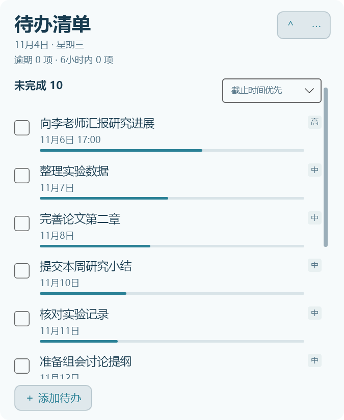
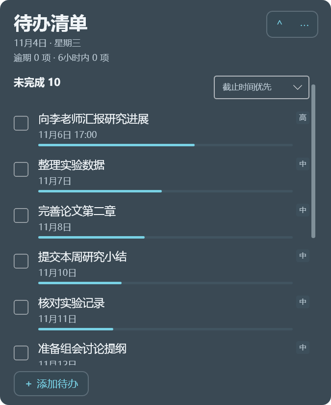
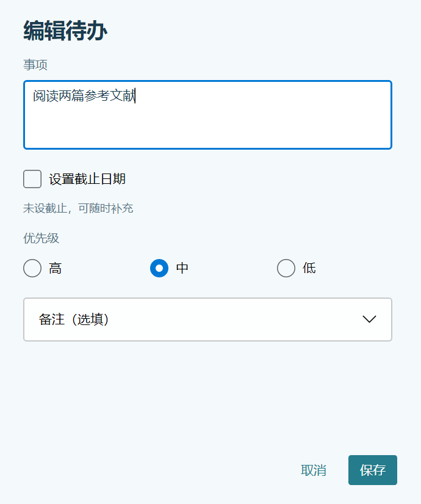

# CornerTodo for macOS · v0.2.0-alpha.1 内测版

版本 **0.2.0-alpha.1**，构建号 **0.2.1**。目标 **macOS 14+**，分别提供 Apple 芯片 ARM64 和 Intel x64 自包含包；普通用户不需要安装 .NET、Python 或其他开发环境。Windows 与 Mac 独立编号。

本轮交付无截止日期、统一操作区和细滚动条，补充旧数据升级前备份、关于与反馈信息。保留任务完成／恢复、备注、优先级、排序、小时／分钟点选、外观设置与默认关闭的右侧贴边胶囊。

## 下载与三分钟试用

| 设备 | 下载文件 |
| --- | --- |
| M1、M2 等 Apple M 系列 Mac | `CornerTodo-macos-v0.2.0-alpha.1-arm64-experimental.zip` |
| Intel Mac | `CornerTodo-macos-v0.2.0-alpha.1-x64-experimental.zip` |

1. 从作者实际分发的地址下载并完整解压，双击 **CornerTodo.app**。不要单独移动包内可执行文件。
2. 添加一条有截止日期和一条无截止日期的测试事项，尝试编辑、取消、完成与恢复。
3. 退出再打开，确认记录仍在；从菜单栏入口恢复面板并退出。
4. 打开「关于 CornerTodo」核对版本／构建号，按 [内测清单](TESTING.md) 反馈结果。

本包没有 Developer ID 发布者签名或 Apple 公证。首次打开若有身份提示，可根据来源与 [Apple 官方说明](https://support.apple.com/en-us/102445) 决定是否运行；若提示损坏、会损坏电脑或立即退出，请记录提示与设备信息。无需关闭系统防护或执行清除隔离属性、重新签名的脚本。

## 已支持的功能

- 添加、编辑、删除、完成与恢复；已完成事项保留划线。
- 截止日期可选，无日期显示「未设截止」，不显示时间条或贡献临期扩大。
- 具体时刻按小时／分钟点选或输入；只有日期时到当天结束后才逾期。
- 多行纯文字备注，高／中／低优先级，两种排序方式。
- 时间已用细条、临期／逾期提示、按截止紧迫程度扩大。
- 浅色、深色、自定义文字／背景与透明度；顶部与添加操作采用统一样式。
- 简约滚动条保留足够的拖动范围；贴边胶囊保持可辨认底色。
- 默认关闭的右侧贴边收起；编辑／菜单期间暂停自动收起，点击胶囊展开。
- 菜单栏显示／恢复／退出，以及版本与反馈信息。

## 当前范围与验证边界

**本版仍为实验性内测包。** Windows 上的共享测试、辅助 Avalonia 界面渲染和两架构交叉构建不代表 Mac 启动、真实鼠标、菜单栏、桌面层级、Spaces、全屏、Retina、多屏或休眠已验收。实际结果请按 [TESTING.md](TESTING.md) 记录。

当前没有接入 Mac 的重复任务设置／生成／管理、提醒卡片／调度或悬浮模式切换，也没有手机端、自动同步或 Mac 登录自启。导入的 Windows 重复、提醒与显示配置会保留，但不会在 Mac 上自动执行；程序会提示相关范围。修改已有事项时保留有效的提醒配置；取消日期或具体时刻会关闭该事项的提醒配置。

## 数据、升级与回退

数据与日志位于：

```text
~/Library/Application Support/CornerTodo/
```

任务文件是 `todos.json`，不写入 `CornerTodo.app`。替换应用前先退出并单独备份整个目录，替换应用后保留原数据目录；应用标识和数据路径保持不变。

本版保存为 **Version 4**。检测到旧格式数据时，迁移前将数据目录复制为独立备份，放在：

```text
~/Library/Application Support/CornerTodo/UpgradeBackups/
```

备份不包含历史 `UpgradeBackups`，避免递归复制；备份失败时停止本次升级并保留旧文件。自动备份不能代替用户另存的完整备份。备份位置与具体提示以本版程序为准。

旧 Mac `0.1.0-alpha.1` 不能读取新版数据。回退前先退出程序，将升级前备份中的数据恢复，再启动旧版。不要让新旧版本同时写入同一目录。手动跨平台迁移先在副本上验证；本工具没有自动同步。

## 界面展示

以下图片由实际 Avalonia 控件在 Windows 辅助环境渲染，使用合成事项，展示布局与配色，**不是 Mac 实机截图**。

| 浅色长列表 | 深色长列表 |
| :---: | :---: |
| [](images/panel-light.png) | [](images/panel-dark.png) |

[](images/no-deadline-editor.png)

[查看长列表与滚动条示例](images/scroll-overflow.png)

## 维护者构建

沿用现有 .NET 10／Avalonia 工程，依赖版本和运行时保持锁定。从项目根目录执行：

```powershell
.\macOS\Build-Mac.ps1 -Architecture all -DotNetPath $dotnetPath -PythonPath $pythonPath
```

变量应为 SDK 与 Python 的可执行文件路径。默认输出 `release/macos/v0.2.0-alpha.1/`，中间产物及缓存位于 `output`；不覆盖旧附件或 Windows 日常程序。详情见 [构建与分发](PUBLISHING.md)、[更新说明](RELEASE_NOTES.md)、[反馈模板](FEEDBACK.txt)。

MIT 及第三方声明见根目录 `LICENSE` 与 [THIRD-PARTY-NOTICES.md](THIRD-PARTY-NOTICES.md)。
